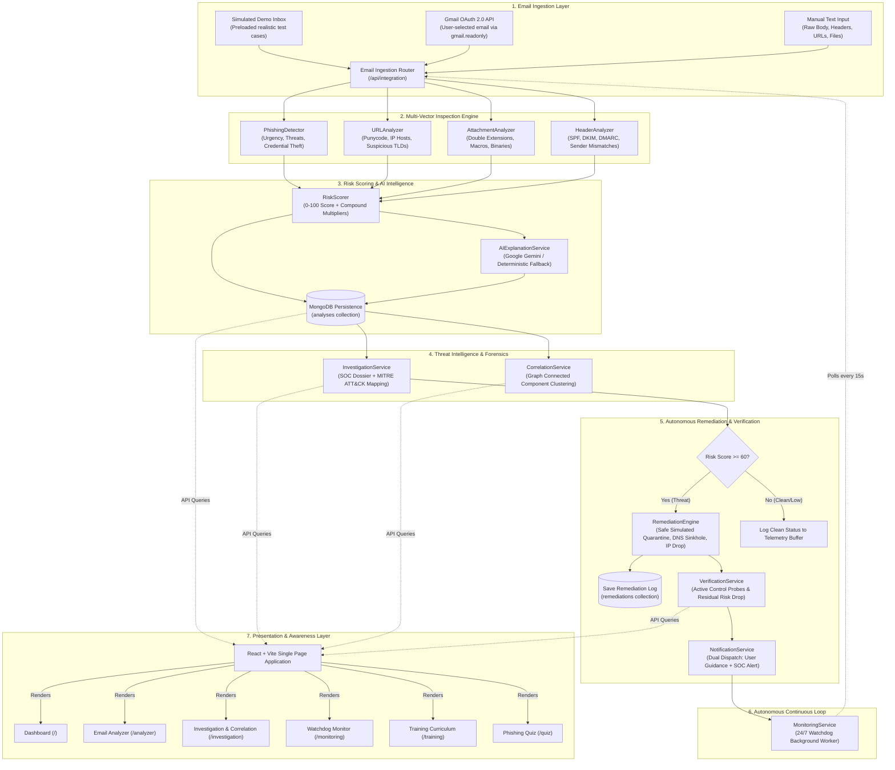
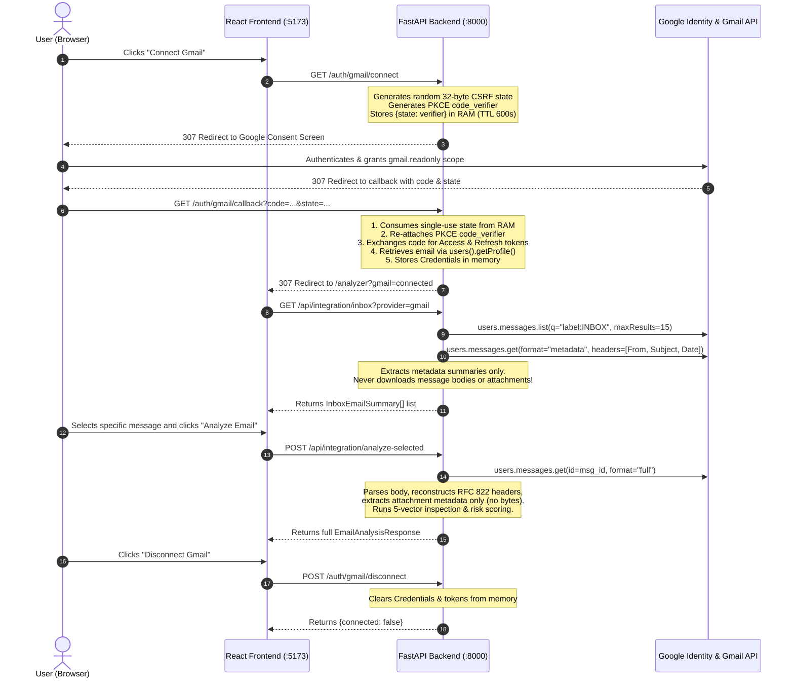

# CYBERSHIELD — AI-Powered Autonomous Cybersecurity & Attack Response Platform

[](https://www.python.org/)
[](https://fastapi.tiangolo.com/)
[](https://react.dev/)
[](https://vitejs.dev/)
[](https://tailwindcss.com/)
[](https://www.mongodb.com/)
[](#13-team-and-academic-project-information)

---

## Table of Contents

1. [Project Overview](#1-project-overview)
2. [Platform Features & Implementation Status](#2-platform-features--implementation-status)
3. [How CyberShield Works (Architecture & Workflow)](#3-how-cybershield-works-architecture--workflow)
4. [Technology Stack](#4-technology-stack)
5. [Project Folder Structure & Code Map](#5-project-folder-structure--code-map)
6. [Gmail OAuth Integration — In-Depth Technical Guide](#6-gmail-oauth-integration--in-depth-technical-guide)
7. [Threat Detection Services — Main Logic & Code Structure](#7-threat-detection-services--main-logic--code-structure)
8. [Installation and Setup Guide (Windows PowerShell)](#8-installation-and-setup-guide-windows-powershell)
9. [Environment Variables Reference](#9-environment-variables-reference)
10. [Testing & Demonstration Checklist](#10-testing--demonstration-checklist)
11. [Database Schema & Data Flow](#11-database-schema--data-flow)
12. [Security Considerations, Limitations & Future Roadmap](#12-security-considerations-limitations--future-roadmap)
13. [Team and Academic Project Information](#13-team-and-academic-project-information)
14. [References & Official Documentation](#14-references--official-documentation)

---

## 1. Project Overview

### What is CyberShield?
**CYBERSHIELD** is an integrated cybersecurity platform that combines automated multi-vector email threat detection, forensic investigation, attack campaign correlation, autonomous remediation playbooks, real-time background monitoring, and interactive employee awareness training into a unified web application.

### The Cybersecurity Problem
Email remains the primary initial access vector (accounting for over 85% of corporate cyber breaches according to cybersecurity industry research). Modern cyber adversaries deploy sophisticated social engineering, brand typosquatting, hidden macro scripts in attachments, and forged authentication headers. Traditional perimeter firewalls and basic spam filters evaluate emails in isolation using static keyword blacklists, missing coordinated multi-stage attacks. Furthermore, traditional tools only generate passive alerts, leaving incident responders overwhelmed by alert fatigue.

### Why Phishing is Dangerous
Phishing emails are not merely annoying spam; they are weaponized delivery mechanisms for:
- **Credential Harvesting:** Stealing administrative logins, banking passwords, and single sign-on (SSO) credentials.
- **Session Hijacking & 2FA Bypass:** Tricking employees into disclosing one-time authentication codes (OTPs).
- **Ransomware & Malware Delivery:** Infiltrating corporate networks through weaponized spreadsheets (`.xlsm`) or executable files masquerading as invoices (`.pdf.exe`).
- **Business Email Compromise (BEC):** Spoofing executive identities to redirect wire transfers or invoice payments.

### Why CyberShield is an Integrated Workflow, Not Just an Email Classifier
Most college projects stop at building a standalone machine learning model that classifies email text as "Spam" or "Ham". Real-world Security Operations Centers (SOCs) require much more:
1. **Multi-Vector Threat Inspection:** Inspecting content, sender domains, embedded URLs, attachment structures, and RFC 822 email headers simultaneously.
2. **Compound Risk Intelligence:** Detecting when deceptive links, forged headers, and urgency tactics occur together to elevate threat severity.
3. **Forensic Investigation:** Mapping technical findings to the **MITRE ATT&CK** matrix and **Lockheed Martin Cyber Kill Chain**.
4. **Threat Correlation & Clustering:** Grouping isolated incidents across time into global **Attack Campaigns** using graph theory.
5. **Autonomous Response & Verification (SOAR):** Simulating automated containment (DNS sinkholing, IP firewall blocking, email quarantine) and recalculating residual risk to verify that the attack surface is neutralized.
6. **24/7 Watchdog Monitoring:** Running continuous asynchronous background scans on mailboxes without requiring manual human uploads.
7. **Human Firewall Awareness:** Providing structured training modules and interactive scenario-based quizzes with instant feedback to educate users against future threats.

---

## 2. Platform Features & Implementation Status

To ensure complete academic transparency, every feature in CyberShield is classified by its true implementation status:

| Module / Feature | Description | Status |
|---|---|---|
| **SOC Executive Dashboard** | Central operational overview rendering real-time telemetry, threat metrics, quick-action shortcuts, recent incidents, and active campaign clusters. | **Implemented & Verified** |
| **Email Threat Analyzer** | Multi-vector evaluation of incoming email messages (sender, subject, body text, attachments, headers) with risk scoring. | **Implemented & Verified** |
| **Simulated Security Inbox** | Pre-loaded realistic threat inbox containing PayPal phishing, macro-enabled payroll sheets, double-extension invoices, and clean university schedules for safe live demonstrations. | **Implemented & Verified** |
| **Manual Threat Submission** | Form allowing manual pasting of raw email headers, message bodies, custom URLs, and attachment metadata for ad-hoc inspection. | **Implemented & Verified** |
| **Gmail OAuth 2.0 Integration** | Connects to Google Workspace / Gmail using Google's official OAuth 2.0 client libraries with the strict `gmail.readonly` permission scope to inspect user-selected emails. | **Implemented & Verified** |
| **Static URL Scanner** | Standalone and inline heuristic inspector analyzing URL structure, punycode/IDN homographs, raw IP hosts, suspicious TLDs, URL shorteners, and deceptive paths without making network requests. | **Implemented & Verified** |
| **Attachment Metadata Scanner** | Safe static file metadata inspector checking for double extensions, executable formats, macro-enabled Office files, disk image containers, and MIME mismatches without running binaries. | **Implemented & Verified** |
| **Email Header Inspector** | RFC 822 header parser evaluating SPF, DKIM, and DMARC alignment, Return-Path rerouting, Reply-To mismatches, and Mail Transfer Agent (MTA) hop chains. | **Implemented & Verified** |
| **Weighted Risk Scorer** | Multi-vector scoring algorithm calculating a 0–100 risk score, risk level (Low/Medium/High/Critical), compound risk multipliers, and plain-English verdict. | **Implemented & Verified** |
| **AI Explanation Assistant** | Generates clear educational explanations and recommendations using Google Gemini (or OpenAI-compatible providers), with an automatic offline deterministic fallback generator when no API key is set. | **Implemented & Verified** |
| **Threat Investigation Center** | Synthesizes analysis data into enterprise SOC Forensic Dossiers, complete with Attack Chain breakdown, Evidence Matrix, and MITRE ATT&CK mapping. | **Implemented & Verified** |
| **Attack Campaign Clustering** | Graph-based Connected Component clustering algorithm that groups related historical incidents sharing infrastructure, domains, attachments, or lure themes into unified campaign clusters. | **Implemented & Verified** |
| **Autonomous Remediation** | Playbook engine that autonomously decides containment actions (email quarantine, perimeter IP drop, DNS sinkhole, credential reset) based on threat severity. | **Simulated / Safe Sandbox** *(Simulated execution for academic safety without modifying live firewalls)* |
| **Remediation Verification** | Automated probe verification testing simulated controls and recalculating post-incident residual risk to prove threat containment. | **Implemented & Verified** |
| **Security Notification Center** | In-memory dual-stream notification dispatcher creating reassuring guidance for the recipient and technical alerts for the SOC administrator. | **Implemented & Verified** |
| **24/7 Watchdog Monitoring** | Background `asyncio` worker polling configured mailboxes on a timer (default: 15s), performing deduplication, running 5-vector inspection, and auto-remediating threats $\ge 60$ score. | **Implemented & Verified** |
| **Cyber Awareness Training** | 5 structured educational modules covering Social Engineering, Deceptive URLs, Weaponized Attachments, Header Forgery, and Incident Response. | **Implemented & Verified** |
| **Interactive Phishing Quiz** | Real-world scenario quiz testing user ability to distinguish legitimate communications from phishing attacks, with instant grading, score breakdown, and red-flag rationales. | **Implemented & Verified** |
| **MongoDB Audit Persistence** | Asynchronous database persistence layer storing full historical analysis records and remediation execution logs using Motor/PyMongo. | **Implemented & Verified** |

---

## 3. How CyberShield Works (Architecture & Workflow)

The platform follows a closed-loop cybersecurity architecture: **Ingest $\rightarrow$ Detect $\rightarrow$ Score $\rightarrow$ Investigate $\rightarrow$ Correlate $\rightarrow$ Remediate $\rightarrow$ Verify $\rightarrow$ Notify $\rightarrow$ Monitor**.

### End-to-End System Flowchart



---

## 4. Technology Stack

### Stack Summary Table

| Technology | Where It Is Used | Why It Is Used |
|---|---|---|
| **Python (3.10+)** | Backend Core Runtime | Robust standard library, rich cybersecurity parsing capabilities (`urllib.parse`, `email.parser`), and extensive async support. |
| **FastAPI (0.115.0)** | Backend REST API Framework | High-performance asynchronous API framework with automatic OpenAPI/Swagger documentation generation and native Pydantic schema validation. |
| **Uvicorn (0.30.6)** | Backend ASGI Web Server | Production-grade, lightning-fast ASGI server for running asynchronous Python applications. |
| **Pydantic (v2.8.2)** | Data Validation & Schemas | Strict type validation, automated JSON parsing, and schema serialization across all API endpoints. |
| **Motor (3.6.0) / PyMongo (4.9.1)** | Database Driver | Asynchronous Python client for non-blocking database queries with MongoDB. |
| **MongoDB** | Database Layer | NoSQL document database storing unstructured threat analyses, header trees, indicators, and remediation audit records. |
| **Google Auth & OAuthLib (1.5.0 / 2.59.1)** | OAuth 2.0 Security | Official Google authentication client implementing the OAuth 2.0 Authorization Code flow with PKCE (`code_verifier`) for secure Gmail connectivity. |
| **Google API Client (2.201.0)** | Gmail API Integration | Official client for listing metadata and fetching selected emails over Google REST endpoints. |
| **Google Gemini API (or Groq / OpenAI)** | AI Natural Language Analysis | Summarizes complex technical indicators into plain-English educational guidance; supplemented by an offline template fallback. |
| **React (18.3.1)** | Frontend User Interface | Component-based, reactive single-page application framework delivering dynamic SOC metrics and interactive scanners. |
| **Vite (5.4.6)** | Frontend Build & Dev Tool | Extremely fast modern development server and bundler replacing legacy Create-React-App. |
| **Tailwind CSS (3.4.12)** | Frontend Styling | Utility-first CSS framework providing a responsive, cybersecurity-themed dark-mode user interface. |
| **Lucide React (0.446.0)** | Frontend Iconography | Clean, consistent vector icons for security shields, indicators, warnings, and network nodes. |
| **React Router DOM (6.26.2)** | Client-Side Navigation | Declarative routing managing transitions between Dashboard, Analyzer, Investigation, Monitoring, Training, and Quiz pages. |
| **Axios (1.7.7)** | Frontend HTTP Client | Promise-based HTTP library communicating with the FastAPI backend REST API. |

### Technical Distinction: Frontend, Backend, REST API, and Database
- **Frontend (Client):** Runs entirely inside the user's web browser (`http://localhost:5173`). Built with React, it renders the visual UI, charts, and interactive forms. It never communicates directly with MongoDB or external mail servers.
- **Backend (Server):** Runs locally on Python and FastAPI (`http://127.0.0.1:8000`). It holds all the business logic: regex pattern matching, scoring algorithms, graph clustering, OAuth secrets, and database access.
- **REST API:** The formal communication contract between frontend and backend. The frontend sends JSON requests (e.g., `POST /api/analyze`) and the backend returns structured JSON responses.
- **Database (MongoDB):** The persistent data storage running on port `27017`. It stores analyzed email records and remediation audit logs across application restarts.

---

## 5. Project Folder Structure & Code Map

### Directory Tree

```
D:\CYBERSECURITY\
│
├── backend\
│   ├── .env                      <-- Local private configuration (DO NOT COMMIT)
│   ├── .env.example              <-- Safe configuration template with placeholders
│   ├── main.py                   <-- FastAPI application entrypoint, CORS, and Lifespan
│   ├── requirements.txt          <-- Pinned Python dependencies
│   │
│   ├── database\
│   │   ├── __init__.py
│   │   └── mongodb.py            <-- Motor async MongoDB client (analyses & remediations collections)
│   │
│   ├── models\
│   │   ├── __init__.py
│   │   └── schemas.py            <-- Pydantic data schemas and validation models
│   │
│   ├── routes\
│   │   ├── __init__.py
│   │   ├── analysis.py           <-- Endpoints for direct email analysis and history retrieval
│   │   ├── auth.py               <-- Gmail OAuth 2.0 connect, callback, status, and disconnect
│   │   ├── correlation.py        <-- Attack campaign detection and incident correlation endpoints
│   │   ├── integration.py        <-- Provider status, inbox listing, and selected email analysis
│   │   ├── investigation.py      <-- Forensic dossier generation and standalone artifact scanner routes
│   │   ├── monitoring.py         <-- 24/7 Watchdog start, stop, status, and manual poll endpoints
│   │   ├── notification.py       <-- In-memory security alerts and notifications inbox endpoints
│   │   ├── remediation.py        <-- Autonomous remediation decision and execution endpoints
│   │   ├── scanner.py            <-- Direct artifact scanners (URL, Headers, Attachment metadata)
│   │   ├── training.py           <-- Training modules curriculum and interactive quiz evaluation
│   │   └── verification.py       <-- Remediation verification and residual risk reassessment
│   │
│   └── services\
│       ├── __init__.py
│       ├── ai_analyzer.py        <-- Gemini / LLM client with deterministic offline fallback
│       ├── attachment_analyzer.py<-- Static attachment metadata, extension, and macro inspector
│       ├── correlation_service.py<-- Multi-vector connected-component graph campaign clustering
│       ├── email_integration.py  <-- Ingestion adapter for Simulated Inbox and Gmail
│       ├── gmail_service.py      <-- Google OAuth 2.0 lifecycle & safe metadata-only Gmail retrieval
│       ├── header_analyzer.py    <-- RFC 822 email header parser (SPF, DKIM, DMARC, Return-Path)
│       ├── investigation_service.py<-- Forensic dossier builder & MITRE ATT&CK mapping
│       ├── monitoring_service.py <-- Background asyncio polling worker & event telemetry buffer
│       ├── notification_service.py<-- Dual-audience notification dispatcher (User advisory + SOC alert)
│       ├── phishing_detector.py  <-- 10-category regex engine for urgency, threats, and impersonation
│       ├── remediation_engine.py <-- Policy decision engine & safe simulated SOAR execution handlers
│       ├── scoring.py            <-- 0-100 weighted risk scoring & compound multiplier engine
│       ├── training_service.py   <-- 5 curriculum modules & scenario-based quiz question bank
│       ├── url_analyzer.py       <-- Static URL heuristic parser (Punycode, IP hosts, shorteners, TLDs)
│       └── verification_service.py<-- Automated control verification & residual risk recalculator
│
├── frontend\
│   ├── index.html                <-- HTML shell
│   ├── package.json              <-- NPM dependencies and build scripts
│   ├── vite.config.js            <-- Vite configuration
│   ├── tailwind.config.js        <-- Tailwind CSS configuration
│   ├── postcss.config.js         <-- PostCSS configuration
│   │
│   └── src\
│       ├── App.jsx               <-- Root React component with React Router route definitions
│       ├── main.jsx              <-- React DOM entrypoint
│       ├── index.css             <-- Global Tailwind styles and custom cyber styling
│       │
│       ├── components\
│       │   ├── Navbar.jsx        <-- Top navigation bar with active route indicators
│       │   └── Footer.jsx        <-- Application footer with academic project details
│       │
│       ├── pages\
│       │   ├── Dashboard.jsx     <-- Central SOC overview, live statistics, and campaign widgets
│       │   ├── Analyzer.jsx      <-- Email inspection workspace (Simulated inbox, Gmail, manual form)
│       │   ├── Investigation.jsx <-- Forensic dossiers, MITRE matrix, scanners, correlation & remediation
│       │   ├── Monitoring.jsx    <-- 24/7 Watchdog control panel, scan logs, and notification feeds
│       │   ├── Training.jsx      <-- Security awareness curriculum with expandable learning modules
│       │   └── Quiz.jsx          <-- Interactive scenario-based phishing detection quiz
│       │
│       └── services\
│           └── api.js            <-- Centralized Axios API client communicating with FastAPI backend
│
└── README.md                     <-- Comprehensive project documentation (this file)
```

### Important Files & Logic Mapping

| File or Folder | What It Does | Important Logic Inside | Connected Components |
|---|---|---|---|
| `backend/main.py` | Application Entrypoint | Initializes FastAPI, sets up CORS middleware for Vite, loads `.env`, registers all 11 API routers, and manages the async database startup/shutdown lifespan. | Connects database, routers, and background services. |
| `backend/database/mongodb.py` | Data Access Layer | Defines `MongoDBManager` using Motor. Connects to `phishing_detection_db`, saves analyses and remediations, retrieves historical records, and provides graceful offline fallback if MongoDB is not running. | Used by `analysis.py`, `integration.py`, `remediation.py`, `monitoring.py`. |
| `backend/services/phishing_detector.py` | Content & Sender Engine | Defines `PhishingDetector` with 10 structured regex indicator categories: urgency, threats, credential requests, OTP requests, financial demands, social engineering, suspicious CTAs, free webmail spoofing, suspicious domains, and brand impersonation. | Supplies indicators to `scoring.py`, `investigation_service.py`. |
| `backend/services/url_analyzer.py` | Static URL Inspector | Pure static URL inspection using `urllib.parse`. Inspects raw IP hosts, punycode/IDN homographs, shorteners, suspicious TLDs (`.xyz`, `.top`), sensitive paths (`/login`, `/banking`), and typosquatted brand names. | Supplies URL details to `scoring.py`, `scanner.py`. |
| `backend/services/attachment_analyzer.py` | Attachment Metadata Scanner | Analyzes file extensions, double extensions (`.pdf.exe`), macro-enabled formats (`.xlsm`, `.docm`), disk containers (`.iso`), and MIME mismatches without ever executing binaries. | Supplies file details to `scoring.py`, `scanner.py`. |
| `backend/services/header_analyzer.py` | RFC 822 Header Analyzer | Uses Python's `email.parser` to evaluate SPF (`Received-SPF`), DKIM, DMARC, Return-Path vs. From domain mismatches, Reply-To redirection, and MTA relay hop counts. | Supplies header details to `scoring.py`, `scanner.py`. |
| `backend/services/scoring.py` | Centralized Risk Scorer | Calculates normalized 0–100 risk score based on weighted indicator points, capped category limits, and 4 compound risk multipliers (e.g., credential theft combined with spoofed header). | Evaluates total risk for `analysis.py`, `integration.py`, `monitoring_service.py`. |
| `backend/services/ai_analyzer.py` | AI Explanation Engine | Generates user-friendly explanations and defense advice via Google Gemini API (or OpenAI/Groq). Includes an automatic offline template generator when no API key is present. | Invoked during email analysis pipeline. |
| `backend/services/gmail_service.py` | Google OAuth & Gmail API | Manages OAuth 2.0 lifecycle using official Google libraries. Implements PKCE, enforces `gmail.readonly` scope, lists inbox metadata summaries, and fetches content only for user-selected messages. | Used by `auth.py`, `email_integration.py`. |
| `backend/services/correlation_service.py` | Threat Correlation Engine | Evaluates multi-incident relationships across 8 weighted vectors (senders, domains, URLs, attachments, TTPs, lures, IPs, time). Uses connected-component graph analysis (BFS) to cluster incidents into campaigns. | Powers `/api/correlation/campaigns` and Dashboard campaign widget. |
| `backend/services/remediation_engine.py` | Autonomous SOAR Engine | Translates threat vectors (score $\ge 60$) into containment playbooks: email quarantine, firewall domain blocks, DNS sinkholes, and credential resets. Runs via safe simulation handlers. | Invoked by `monitoring_service.py` and `/api/remediation`. |
| `backend/services/verification_service.py` | Control Verification Engine | Probes executed containment actions, confirms mitigation status, and recalculates post-remediation residual risk (reducing score from e.g. 94 down to safe levels). | Invoked after remediation execution. |
| `backend/services/monitoring_service.py` | 24/7 Watchdog Worker | Asynchronous background polling worker running on an `asyncio.Task` loop (15s interval). Ingests mail, deduplicates message IDs, inspects threats, triggers auto-remediation, and streams telemetry events. | Controls automated detection in `Monitoring.jsx`. |
| `backend/services/training_service.py` | Education Curriculum & Quiz | Contains 5 structured cybersecurity awareness modules and an interactive quiz bank with automated grading and indicator-based feedback. | Powers `Training.jsx` and `Quiz.jsx`. |
| `frontend/src/services/api.js` | Centralized API Client | Configures Axios with base URL `http://127.0.0.1:8000` and exports clean promise-based functions for all 11 backend service domains. | Used across all frontend page components. |

---

## 6. Gmail OAuth Integration — In-Depth Technical Guide

The Gmail integration enables users to inspect real emails from their Google Workspace or personal Gmail inbox without compromising security.

### 13-Step Workflow



### Core OAuth Concepts Explained Simply

- **OAuth 2.0:** An industry-standard authorization protocol that allows a third-party application (CyberShield) to access user resources (emails) on another service (Google) without ever seeing or handling the user's Google password.
- **Client ID:** A public identifier for our application registered in Google Cloud Console.
- **Client Secret:** A private cryptographic secret shared between our backend and Google to authenticate token exchange requests. Must **never** be exposed in frontend code or Git repositories.
- **Redirect URI:** The exact whitelisted URL where Google sends the user after consent (`http://127.0.0.1:8000/auth/gmail/callback`).
- **Authorization Code:** A short-lived, single-use credential returned by Google in the browser redirect. The backend exchanges it for access tokens.
- **Access Token:** A short-lived credential (typically valid for 1 hour) used in HTTP headers to make authorized API requests to Google.
- **Refresh Token:** A long-lived credential used by the backend to obtain new access tokens automatically when they expire, without prompting the user to log in again.
- **OAuth State:** A cryptographically random 32-byte string (`secrets.token_urlsafe(32)`) sent to Google and returned in the callback. The backend validates it to prevent **Cross-Site Request Forgery (CSRF)** attacks.
- **PKCE (Proof Key for Code Exchange):** A security extension (RFC 7636) where a random secret (`code_verifier`) is generated during authorization and verified during token exchange, preventing authorization code interception.
- **`gmail.readonly` Scope:** The narrowest possible permission requested (`https://www.googleapis.com/auth/gmail.readonly`). CyberShield can only read email data. It **cannot** send emails, compose drafts, delete messages, modify settings, or change passwords.

### Exact Gmail API Methods Used in the Code

Based strictly on [`backend/services/gmail_service.py`](file:///d:/CYBERSECURITY/backend/services/gmail_service.py):
1. `client.users().getProfile(userId="me").execute()`: Fetches the authenticated user's email address for display in the UI.
2. `client.users().messages().list(userId="me", maxResults=..., q="label:INBOX").execute()`: Lists message IDs and thread IDs currently in the user's Inbox.
3. `client.users().messages().get(userId="me", id=msg_id, format="metadata", metadataHeaders=["From", "Subject", "Date"]).execute()`: Retrieves only top-level headers and text snippets for the inbox summary list.
4. `client.users().messages().get(userId="me", id=message_id, format="full").execute()`: Fetches the full MIME payload **only** when the user explicitly clicks on a message to analyze it.

### Security Guarantees & Implementation Reality
- **Tokens Kept on Backend:** Access and refresh tokens are stored **strictly in-memory** within the backend server process (`self._credentials`). They are never sent to the browser or stored in localStorage.
- **Zero Raw Attachment Downloads:** When inspecting attachments from Gmail, CyberShield reads only the MIME metadata (`filename`, `mimeType`, `size`). It **never** calls `users.messages.attachments.get()` or downloads binary files to disk.
- **Explicit User-Driven Analysis:** Connecting Gmail does **not** download or scan the user's entire mailbox. Only the single message explicitly clicked by the user is retrieved and analyzed.
- **Disconnect Semantics:** Calling `POST /auth/gmail/disconnect` purges credentials, active tokens, and OAuth states from server RAM. It does not revoke the consent grant on Google's authorization servers.
- **Academic Environment Notice:** The Google Cloud OAuth consent screen is configured in "Testing" mode for development. Only Google accounts explicitly added as "Test Users" in the Google Cloud Console project can authenticate.

---

## 7. Threat Detection Services — Main Logic & Code Structure

### 7.1 Email Content & Social Engineering Analysis
- **File & Class:** [`backend/services/phishing_detector.py`](file:///d:/CYBERSECURITY/backend/services/phishing_detector.py) $\rightarrow$ `PhishingDetector.analyze()`
- **Input Data:** `sender: str`, `subject: str`, `body: str`
- **Checks Performed:** Evaluates 10 structured regex indicator categories:
  - Urgency language (`\burgent\b`, `\bwithin \d+ hours\b`, `\baction required\b`)
  - Threat language (`\baccount.{0,30}suspend\w*\b`, `\blegal action\b`)
  - Credential harvesting (`\b(enter|verify|confirm).{0,40}password\b`)
  - OTP/2FA requests (`\b(share|send|enter).{0,30}(otp|one-time password|verification code)\b`)
  - Financial demands (`\b(wire transfer|unpaid invoice|cryptocurrency|bitcoin)\b`)
  - Social engineering pressure (`\bconfidential\b`, `\bdo not tell\b`)
  - Suspicious calls to action (`\bclick here immediately\b`)
  - Brand impersonation (identifying brand keywords in sender or body)
- **Output:** `List[IndicatorDetail]` (indicator name, severity, plain-English description, captured text evidence, base score contribution).
- **Next Stage:** Fed into `RiskScorer` and `InvestigationService`.
- **Harmless Example:** Subject: *"Urgent: Your account access will be terminated within 24 hours. Confirm your password below."* $\rightarrow$ Triggers `urgency_language`, `threat_language`, and `credential_request`.

### 7.2 Static URL Analysis
- **File & Class:** [`backend/services/url_analyzer.py`](file:///d:/CYBERSECURITY/backend/services/url_analyzer.py) $\rightarrow$ `URLAnalyzer.analyze_all()`
- **Input Data:** `text: str` (email body) or single URL string
- **Checks Performed:** Uses `urllib.parse` for static inspection without network requests:
  - IPv4 address used directly as hostname (e.g. `http://192.168.1.50/login`)
  - Known URL shortener services (`bit.ly`, `tinyurl.com`, `t.co`)
  - Suspicious/cheap TLDs (`.xyz`, `.top`, `.tk`, `.click`, `.link`)
  - Sensitive authentication paths (`/login`, `/signin`, `/verify`, `/banking`)
  - Brand typosquatting (brand name in hostname, but not in official brand domain list)
  - IDN Homograph / Punycode attacks (`xn--`)
  - Non-HTTPS unencrypted transport (`http://`)
  - Credential parameters embedded in query strings (`?user=`, `?password=`, `?token=`)
- **Output:** `Tuple[List[str], List[URLAnalysisDetail]]` (found URLs, suspicious flags, threat reasons, score contributions).
- **Next Stage:** Fed into `RiskScorer` (capped at max 35 points).
- **Harmless Example:** `http://paypal-verification.fake-security.xyz/login?user=auth` $\rightarrow$ Triggers Raw HTTP, Suspicious TLD (`.xyz`), Brand Impersonation (`paypal`), and Suspicious Path (`/login`).

### 7.3 Attachment Metadata Analysis
- **File & Class:** [`backend/services/attachment_analyzer.py`](file:///d:/CYBERSECURITY/backend/services/attachment_analyzer.py) $\rightarrow$ `AttachmentAnalyzer.analyze_all()`
- **Input Data:** `List[AttachmentMetadata]` (`filename`, `file_size_bytes`, `content_type`)
- **Checks Performed:** Pure static inspection without binary execution:
  - Dangerous executable extensions (`.exe`, `.scr`, `.bat`, `.vbs`, `.ps1`, `.hta`, `.jar`)
  - Macro-enabled Office documents (`.xlsm`, `.docm`, `.pptm`)
  - Disk images & container archives (`.iso`, `.img`, `.vhd`, `.7z`)
  - Deceptive double extensions (e.g., `Invoice_2026.pdf.exe`)
  - Right-to-Left Override (RTLO) unicode deception characters
  - MIME type mismatches (e.g., filename claims `.pdf` but MIME type is `application/x-msdownload`)
- **Output:** `Tuple[List[str], List[AttachmentAnalysisDetail]]` (filenames, category, risk level, threat reasons).
- **Next Stage:** Fed into `RiskScorer` (capped at max 40 points).
- **Harmless Example:** `Invoice_98412_Overdue.pdf.exe` $\rightarrow$ Triggers Double Extension Deception and Direct Executable Program.

### 7.4 Email Header Analysis
- **File & Class:** [`backend/services/header_analyzer.py`](file:///d:/CYBERSECURITY/backend/services/header_analyzer.py) $\rightarrow$ `HeaderAnalyzer.analyze_headers()`
- **Input Data:** `raw_headers: str` (RFC 822 formatted header string)
- **Checks Performed:** Parses headers using Python's `email.parser`:
  - SPF (Sender Policy Framework) authentication status in `Received-SPF` or `Authentication-Results` (`pass`, `fail`, `softfail`)
  - DKIM (DomainKeys Identified Mail) cryptographic signature verification (`pass`, `fail`, `none`)
  - DMARC policy alignment status (`pass`, `fail`, `none`)
  - Sender alignment: Displayed `From` domain vs. envelope `Return-Path` domain
  - Reply-To redirection: Displayed `From` domain vs. `Reply-To` domain
  - MTA relay hop counting and extraction of originating relay IP addresses
- **Output:** `HeaderAnalysisDetail` (auth status, sender alignment flags, hop list, score contribution).
- **Next Stage:** Fed into `RiskScorer` (capped at max 40 points).
- **Harmless Example:** `From: "PayPal" <security@paypal.com>` with `Return-Path: <bounce@attacker-vps.xyz>` and `Received-SPF: fail` $\rightarrow$ Triggers SPF Failure (+20) and Domain Mismatch (+18).

### 7.5 Weighted Risk Scoring & Compound Multipliers
- **File & Class:** [`backend/services/scoring.py`](file:///d:/CYBERSECURITY/backend/services/scoring.py) $\rightarrow$ `RiskScorer.calculate_score()`
- **Input Data:** Indicators, URL details, attachment details, and header details
- **Logic:**
  1. Computes base scores: `content_score + sender_score + url_score + attachment_score + header_score`.
  2. Evaluates **Compound Risk Multipliers**:
     - *Rule A (+15%):* Credential/OTP request combined with untrusted sender or failed header authentication.
     - *Rule B (+15%):* Suspicious attachment combined with urgency or spoofed header.
     - *Rule C (+10%):* Technical authentication failure (SPF/DKIM/DMARC) aligns with brand impersonation.
     - *Rule D (+10%):* Credential request combined with coercive urgency.
  3. Caps final score between 0 and 100.
  4. Maps score to threat level: `0-30: Low`, `31-60: Medium`, `61-80: High`, `81-100: Critical`.
- **Output:** `Tuple[int, str, str, ScoreBreakdown]` (final score, risk level, verdict, breakdown).
- **Next Stage:** Persisted to database; triggers autonomous remediation if score $\ge 60$.

### 7.6 AI Explanation & Fallback
- **File & Class:** [`backend/services/ai_analyzer.py`](file:///d:/CYBERSECURITY/backend/services/ai_analyzer.py) $\rightarrow$ `AIExplanationService.generate_explanation()`
- **Input Data:** Analysis summary, risk score, verdict, indicators, and URLs
- **Checks Performed:** If `AI_API_KEY` is configured and not `"your_api_key_here"`, invokes Google Gemini API (`gemini-1.5-flash`). If key is missing, invalid, or API encounters a network timeout, it seamlessly falls back to `_generate_fallback_explanation()`.
- **Output:** Natural-language markdown explanation synthesizing why the message was flagged and advising the user on safe defensive actions.

### 7.7 Threat Investigation & MITRE ATT&CK Mapping
- **File & Class:** [`backend/services/investigation_service.py`](file:///d:/CYBERSECURITY/backend/services/investigation_service.py) $\rightarrow$ `ThreatInvestigationService.generate_dossier()`
- **Input Data:** Completed analysis dictionary
- **Logic:** Synthesizes an enterprise SOC Forensic Investigation Dossier (`INV-XXXXXXXX`):
  - Formulates an Attack Chain breakdown across the 5 threat vectors.
  - Builds an Evidence Matrix linking indicators to captured text artifacts.
  - Maps indicators to **MITRE ATT&CK** techniques:
    - `T1566.002` *(Spearphishing Link)* for deceptive URLs.
    - `T1566.001` *(Spearphishing Attachment)* for dangerous files and macros.
    - `T1204.002` *(User Execution: Malicious File)* for execution lures.
    - `T1059` *(Command and Scripting Interpreter)* for macro scripts.
  - Maps events to **Lockheed Martin Cyber Kill Chain** stages (Reconnaissance $\rightarrow$ Delivery $\rightarrow$ Exploitation).
- **Output:** `ThreatInvestigationDossier` object.

### 7.8 Attack Campaign Correlation
- **File & Class:** [`backend/services/correlation_service.py`](file:///d:/CYBERSECURITY/backend/services/correlation_service.py) $\rightarrow$ `ThreatCorrelationService.cluster_campaigns()`
- **Input Data:** List of all historical analysis records from MongoDB
- **Logic:**
  1. Compares every pair of incidents across 8 threat vectors: identical sender (+40), custom sender domain (+35), shared URL (+40) or domain (+30), identical attachment (+30) or payload extension (+15), shared MITRE TTPs (+10 to +20), subject lure keywords (+15), originating relay IP (+35), and temporal proximity within 24 hours (+10).
  2. Constructs an undirected graph where an edge connects incidents with correlation score $\ge 45$.
  3. Uses **Breadth-First Search (BFS)** to identify connected components of size $\ge 2$.
  4. Synthesizes a `CampaignCluster` for each group, calculating average threat score, common indicators, and time window.
- **Output:** `CampaignDetectionResponse` (total campaigns, clusters, isolated incident count).

### 7.9 Autonomous Remediation & Verification
- **File & Class:** [`backend/services/remediation_engine.py`](file:///d:/CYBERSECURITY/backend/services/remediation_engine.py) & [`backend/services/verification_service.py`](file:///d:/CYBERSECURITY/backend/services/verification_service.py)
- **Input Data:** Analysis record with risk score $\ge 60$
- **Logic:**
  - `RemediationEngine`: Autonomously decides and executes simulated actions:
    - `EMAIL_QUARANTINE`: Isolates the message in a secure vault.
    - `NETWORK_DOMAIN_BLOCK`: Generates perimeter firewall drop rules and DNS sinkholes for malicious domains.
    - `CREDENTIAL_RESET_FORCE`: Flags victim accounts for forced password resets.
  - `VerificationService`: Automated inspector probes the applied controls to verify containment and recalculates **residual risk** (reducing threat score from e.g. 94 down to $\le 15$ and status to `FULLY_CONTAINED`).
- **Output:** `RemediationExecutionResult` and `RiskReassessmentReport`.

### 7.10 24/7 Watchdog Monitoring
- **File & Class:** [`backend/services/monitoring_service.py`](file:///d:/CYBERSECURITY/backend/services/monitoring_service.py) $\rightarrow$ `MonitoringService`
- **Input Data:** Mailbox messages polled every 15 seconds
- **Logic:** Background `asyncio.Task` loop:
  1. Polls selected provider (`simulated` or `gmail`).
  2. Checks deduplication set `self._processed_message_ids` to prevent analyzing the same email twice.
  3. Executes the full 5-vector inspection and scoring pipeline.
  4. Saves results to MongoDB `analyses` collection.
  5. If risk score $\ge 60$, autonomously triggers remediation, verification, and notification dispatch.
  6. Emits structured events to an in-memory rolling buffer (last 50 events) for real-time frontend streaming.

### 7.11 Cybersecurity Training & Quiz
- **File & Class:** [`backend/services/training_service.py`](file:///d:/CYBERSECURITY/backend/services/training_service.py) $\rightarrow$ `TrainingService`
- **Input Data:** Student quiz submission (`answers: Dict[str, str]`)
- **Logic:** Evaluates user answers against verified question criteria, calculates awareness score percentage, grades performance (Advanced Defender / Proficient / Needs Improvement), and returns detailed indicator breakdowns explaining why each scenario was legitimate or malicious.

---

## 8. Installation and Setup Guide (Windows PowerShell)

Follow these exact steps to set up and run CyberShield locally on Windows.

### Prerequisites
- **Operating System:** Windows 10 or 11
- **Python:** Version 3.10 or higher (`python --version`)
- **Node.js:** Version 18 or higher (`node --version`)
- **MongoDB:** MongoDB Community Server installed and running locally on `localhost:27017` (Optional: The application runs with graceful in-memory fallback if MongoDB is not installed).

---

### Step 1: Open Windows PowerShell & Navigate to Workspace

```powershell
# Open Windows PowerShell and navigate to the project directory
cd D:\CYBERSECURITY
```

---

### Step 2: Set Up Backend Virtual Environment

```powershell
# Navigate to the backend directory
cd D:\CYBERSECURITY\backend

# Create a Python virtual environment named 'venv' (if not already created)
python -m venv venv

# Activate the virtual environment
.\venv\Scripts\Activate.ps1
```

> **Note on PowerShell Execution Policy:** If you encounter an execution policy error when activating the virtual environment, run:
> ```powershell
> Set-ExecutionPolicy -ExecutionPolicy RemoteSigned -Scope CurrentUser
> ```

---

### Step 3: Install Backend Dependencies

```powershell
# With (venv) active, upgrade pip and install dependencies
python -m pip install --upgrade pip
pip install -r requirements.txt
```

---

### Step 4: Configure Backend Environment Variables

```powershell
# Create your local private .env file from the template (if not already present)
Copy-Item .env.example .env
```

Open `backend\.env` in your text editor (such as VS Code or Notepad) and configure your variables:
```env
# MongoDB Connection
MONGODB_URL=mongodb://localhost:27017
DATABASE_NAME=phishing_detection_db

# AI Provider Settings (Optional: leave as fallback or add your key)
AI_PROVIDER=gemini
AI_API_KEY=your_api_key_here
AI_MODEL_NAME=gemini-1.5-flash

# App Settings
APP_ENV=development
APP_PORT=8000

# Gmail OAuth Settings (Optional: configure if testing live Gmail integration)
GMAIL_CLIENT_ID=your_client_id_here.apps.googleusercontent.com
GMAIL_CLIENT_SECRET=your_client_secret_here
GMAIL_REDIRECT_URI=http://127.0.0.1:8000/auth/gmail/callback
FRONTEND_URL=http://localhost:5173
```

---

### Step 5: Start the Backend FastAPI Server

```powershell
# Start Uvicorn ASGI server with live reloading
uvicorn main:app --reload --host 127.0.0.1 --port 8000
```

Verify that the backend is running:
- **API Health Check:** Open [http://127.0.0.1:8000/api/health](http://127.0.0.1:8000/api/health)
- **Interactive Swagger Docs:** Open [http://127.0.0.1:8000/docs](http://127.0.0.1:8000/docs)

---

### Step 6: Install Frontend Dependencies & Start React App

Open a **new, separate Windows PowerShell terminal window**:

```powershell
# Navigate to the frontend directory
cd D:\CYBERSECURITY\frontend

# Install node dependencies
npm install

# Start Vite development server
npm run dev
```

The terminal will display:
```
  VITE v5.4.6  ready in 240 ms

  ➜  Local:   http://localhost:5173/
  ➜  Network: use --host to expose
```

---

### Step 7: Open CyberShield in Your Browser

Open your web browser and navigate to:
**[http://localhost:5173](http://localhost:5173)**

---

## 9. Environment Variables Reference

The application uses environment variables defined in `backend/.env`. Never commit this file to version control.

> [!IMPORTANT]
> **Private Configuration vs. Public Template:**
> - `backend/.env.example` is a committed public template that contains safe placeholders.
> - `backend/.env` is your local private file containing actual configuration and secrets.
> - When preparing to initialize Git or push to GitHub, ensure that `.env`, `venv/`, and `node_modules/` are explicitly listed in your `.gitignore` file so that credentials are never leaked.

| Variable Name | Description | Required? | Safe Example Placeholder |
|---|---|---|---|
| `MONGODB_URL` | MongoDB connection URI | **Optional** (defaults to `mongodb://localhost:27017`) | `mongodb://localhost:27017` |
| `DATABASE_NAME` | Name of the database to store analyses and logs | **Optional** (defaults to `phishing_detection_db`) | `phishing_detection_db` |
| `AI_PROVIDER` | LLM provider (`gemini`, `groq`, `openai`, or `fallback`) | **Optional** (defaults to `gemini`) | `gemini` |
| `AI_API_KEY` | API key for generative explanation assistant | **Optional** (falls back to offline templates if unset) | `YOUR_GEMINI_API_KEY` |
| `AI_MODEL_NAME` | Model identifier string | **Optional** (defaults to `gemini-1.5-flash`) | `gemini-1.5-flash` |
| `APP_ENV` | Application environment identifier | **Optional** (defaults to `development`) | `development` |
| `APP_PORT` | Backend server port | **Optional** (defaults to `8000`) | `8000` |
| `FRONTEND_URL` | Frontend URL for OAuth redirects | **Optional** (defaults to `http://localhost:5173`) | `http://localhost:5173` |
| `GMAIL_CLIENT_ID` | Google Cloud Console OAuth 2.0 Web Client ID | **Required only for Gmail feature** | `YOUR_CLIENT_ID.apps.googleusercontent.com` |
| `GMAIL_CLIENT_SECRET` | Google Cloud Console OAuth 2.0 Web Client Secret | **Required only for Gmail feature** | `YOUR_CLIENT_SECRET` |
| `GMAIL_REDIRECT_URI` | Whitelisted OAuth 2.0 redirect endpoint | **Required only for Gmail feature** | `http://127.0.0.1:8000/auth/gmail/callback` |

---

## 10. Testing & Demonstration Checklist

Follow this checklist to test and demonstrate every feature of CyberShield during an academic evaluation or viva:

- [ ] **1. API Health Check:**
  - Visit `http://127.0.0.1:8000/api/health`.
  - Expect JSON response: `{"status": "ok", "version": "2.2.0", "database_connected": true/false}`.
- [ ] **2. SOC Dashboard Overview:**
  - Visit `http://localhost:5173/`.
  - Verify that system status badges display **Operational**, metrics render, and quick shortcuts work.
- [ ] **3. Simulated Phishing Detection (Critical Risk):**
  - Go to **Email Analyzer** (`/analyzer`).
  - In the **Simulated Security Inbox**, select `sim_msg_001` (*"URGENT: Unauthorized Account Access Detected"* from PayPal spoof).
  - Click **Analyze Email**.
  - Expect: Threat Level **CRITICAL** (Risk Score ~94/100), detected indicators for urgency, credential theft, and punycode URL.
- [ ] **4. Simulated Weaponized Attachment Detection:**
  - In the Simulated Inbox, select `sim_msg_002` (*"Q3 Salary Adjustment & Bonus Calculation"* with `.xlsm` macro attachment).
  - Click **Analyze Email**.
  - Expect: Detection of Macro-Enabled Excel Workbook (`.xlsm`) and high risk score.
- [ ] **5. Simulated Legitimate Email (Clean):**
  - In the Simulated Inbox, select `sim_msg_004` (*"Fall Semester Final Examination Schedule"* from university domain).
  - Click **Analyze Email**.
  - Expect: Threat Level **LOW** (Risk Score $\le 10/100$), verdict *"Likely Legitimate"*, passing SPF/DKIM/DMARC headers.
- [ ] **6. Standalone Threat Scanners:**
  - Go to **Investigation** $\rightarrow$ **Standalone Scanners** (`/investigation?tab=scanners`).
  - Test URL Scanner: Enter `http://185.220.101.5/verify-account` $\rightarrow$ Expect raw IP host alert.
  - Test Attachment Scanner: Enter `Statement.pdf.exe` $\rightarrow$ Expect Double Extension alert.
  - Test Header Scanner: Enter headers with mismatched `From` and `Return-Path` $\rightarrow$ Expect domain mismatch alert.
- [ ] **7. Threat Investigation Center & MITRE ATT&CK:**
  - In **Investigation** $\rightarrow$ **Incident Dossiers** (`/investigation?tab=dossier`), select an incident.
  - Expect: Forensic Attack Chain breakdown, Evidence Matrix, and MITRE ATT&CK technique mapping (`T1566.002`, `T1566.001`).
- [ ] **8. Attack Campaign Clustering:**
  - Go to **Investigation** $\rightarrow$ **Campaign Correlation** (`/investigation?tab=correlation`).
  - Click **Refresh Clusters**.
  - Expect: Graph clustering groups historical PayPal or invoice incidents into unified campaign cards sharing common domains and TTPs.
- [ ] **9. Autonomous Remediation & Residual Risk Verification:**
  - Go to **Investigation** $\rightarrow$ **Autonomous Remediation** (`/investigation?tab=remediation`).
  - Select a Critical incident and click **Execute Remediation**.
  - Expect: Simulated actions executed (email quarantine, firewall domain block, credential reset).
  - Click **Verify & Reassess Residual Risk**.
  - Expect: Residual risk score drops from 94 to $<20$, status updates to `FULLY_CONTAINED`.
- [ ] **10. 24/7 Watchdog Background Monitoring:**
  - Go to **Watchdog** (`/monitoring`).
  - Click **Poll Now** or toggle **Start Monitoring**.
  - Watch the live telemetry log stream events as emails are ingested, analyzed, and auto-remediated in the background.
- [ ] **11. Security Awareness Training Curriculum:**
  - Go to **Training** (`/training`).
  - Click through the 5 modules (Social Engineering, Deceptive URLs, Macro Malware, Header Forgery, Incident Reporting).
- [ ] **12. Interactive Phishing Quiz:**
  - Go to **Quiz** (`/quiz`).
  - Complete the scenario-based questions and submit.
  - Expect: Instant scoring percentage, Defender Grade, and red-flag indicator explanations.
- [ ] **13. Database Persistence Verification:**
  - Return to the **Dashboard** (`/`).
  - Check the **Recent Threat Incidents** feed $\rightarrow$ verify that recently analyzed incidents are persisted and listed.

---

## 11. Database Schema & Data Flow

### Database Configuration
- **Database Engine:** MongoDB Community Server (default port: `27017`)
- **Database Name:** `phishing_detection_db` (configured via `DATABASE_NAME` in `.env`)
- **Async Client:** Motor (`AsyncIOMotorClient`) with a 3-second server selection timeout.

### MongoDB Collections Used

1. **`analyses` Collection:**
   Stores completed email threat inspections. Each document contains:
   ```json
   {
     "_id": "ObjectId(...)",
     "analysis_id": "6716a8...",
     "sender": "security-alert@paypal-update.xyz",
     "subject": "URGENT: Unauthorized Account Access Detected",
     "body": "Dear Customer...",
     "raw_headers": "From: ... Return-Path: ... Received-SPF: fail",
     "risk_score": 94,
     "risk_level": "critical",
     "verdict": "Critical Risk — Multi-vector attack detected...",
     "indicators": [
       {
         "indicator": "urgency_language",
         "severity": "medium",
         "evidence": ["URGENT"],
         "score_contribution": 12
       }
     ],
     "urls_found": ["http://paypal-verification.fake-security.xyz/..."],
     "url_analysis": [...],
     "attachment_analysis": [...],
     "header_analysis": {...},
     "score_breakdown": {...},
     "ai_explanation": "This email is a confirmed credential phishing attempt...",
     "recommendations": [...],
     "analyzed_at": "2026-10-22T14:30:00Z"
   }
   ```

2. **`remediations` Collection:**
   Stores records of autonomous or manual remediation playbook executions:
   ```json
   {
     "_id": "ObjectId(...)",
     "remediation_id": "REM-4A1B2C3D",
     "analysis_id": "6716a8...",
     "threat_level": "CRITICAL",
     "risk_score": 94,
     "is_dry_run": true,
     "executed_actions": [
       {
         "action_id": "ACT-001",
         "action_type": "email_quarantine",
         "target": "message_id:6716a8...",
         "status": "simulated_success"
       }
     ],
     "overall_status": "completed",
     "executed_at": "2026-10-22T14:31:00Z"
   }
   ```

### What Stays In-Memory (Not Persisted to Disk)
- **OAuth Session Tokens:** Gmail credentials (`self._credentials`) and PKCE state verifiers are kept in RAM for security and cleared on restart or disconnect.
- **Notification Center Alerts:** Security notifications (`self._notifications` in `NotificationService`) are kept in server memory.
- **Watchdog Telemetry Log:** The rolling 50-event monitoring stream (`self._event_log`) is maintained in RAM.
- **Training Curriculum & Quiz Questions:** Maintained as static Python dictionaries in memory.

### Offline Fallback Resilience
If MongoDB is offline or unavailable:
- `db_manager.is_connected` evaluates to `False`.
- The application logs a warning and **continues running seamlessly**.
- The Email Analyzer and Standalone Scanners return full live analysis results in the API response without crashing.
- Historical saving is gracefully skipped until MongoDB is restarted.

---

## 12. Security Considerations, Limitations & Future Roadmap

### Honest Security & Implementation Reality

1. **Simulated vs. Real Remediation:**
   All firewall blocking (`iptables`/perimeter drop), DNS sinkholing, and email quarantine actions are executed through **simulated sandbox handlers**. In an academic capstone environment, executing real firewall rule modifications on the host computer could cause accidental network lockouts. The simulation logs exact CLI commands, parameters, and execution statuses without system risk.
2. **Static Metadata-Only Attachment Analysis:**
   CyberShield inspects file naming, extensions, macro formats, and MIME headers. It does not run a dynamic malware detonation sandbox (such as Cuckoo Sandbox) or execute binaries in a virtual machine.
3. **Static URL Heuristics:**
   URL analysis is purely static (`urllib.parse`). The application never makes outbound network connections to suspicious links, protecting the host machine from web-based exploits.
4. **Local Single-User Architecture:**
   CyberShield is currently designed as a single-user security operations console. User authentication (JWT login, multi-tenant roles) is not implemented; anyone with access to `localhost:5173` has administrative access.
5. **In-Memory Credential Handling:**
   OAuth credentials exist in backend process memory. Restarting the backend server terminates active Gmail sessions, requiring the user to click Connect again.

### Recommended Future Roadmap
- [ ] Integration with a live Sandbox VM (e.g., Cuckoo or CAPE) for dynamic malware detonation.
- [ ] Enterprise SIEM forwarders (Syslog / CEF format) to export alerts to Splunk or Microsoft Sentinel.
- [ ] Role-Based Access Control (RBAC) supporting Analyst, SOC Manager, and Trainee roles.
- [ ] Native IMAP / Microsoft Graph API integration for enterprise Outlook support.
- [ ] Persistent database storage for notifications and user quiz progress.

---

## 13. Team and Academic Project Information

This project was developed as a **Cyber Security Mini Project** for the Master of Computer Applications (MCA) program.

### Team Members

| Sr. No. | Student Name | Roll Number | Class / Division |
|:---:|---|:---:|:---:|
| 1 | **Aarmee Patel** | A001 | MCA — B1 |
| 2 | **Kirti Gummerla** | A027 | MCA — B1 |
| 3 | **Richa Patel** | A035 | MCA — B1 |

- **Institution:** Mukesh Patel School of Technology Management & Engineering (MPSTME)
- **University:** SVKM's Narsee Monjee Institute of Management Studies (NMIMS University)
- **Academic Year:** 2026–2027

---

## 14. References & Official Documentation

- **FastAPI Documentation:** [https://fastapi.tiangolo.com/](https://fastapi.tiangolo.com/)
- **React Official Docs:** [https://react.dev/](https://react.dev/)
- **Vite Guide:** [https://vitejs.dev/guide/](https://vitejs.dev/guide/)
- **MongoDB & Motor Driver:** [https://motor.readthedocs.io/](https://motor.readthedocs.io/)
- **Google OAuth 2.0 Guide:** [https://developers.google.com/identity/protocols/oauth2](https://developers.google.com/identity/protocols/oauth2)
- **Gmail REST API Reference:** [https://developers.google.com/gmail/api/reference/rest](https://developers.google.com/gmail/api/reference/rest)
- **MITRE ATT&CK Matrix for Enterprise:** [https://attack.mitre.org/](https://attack.mitre.org/)
- **RFC 822 / 5322 (Internet Message Format):** [https://datatracker.ietf.org/doc/html/rfc5322](https://datatracker.ietf.org/doc/html/rfc5322)
- **RFC 7636 (Proof Key for Code Exchange by OAuth Public Clients - PKCE):** [https://datatracker.ietf.org/doc/html/rfc7636](https://datatracker.ietf.org/doc/html/rfc7636)
- **RFC 7208 (Sender Policy Framework - SPF):** [https://datatracker.ietf.org/doc/html/rfc7208](https://datatracker.ietf.org/doc/html/rfc7208)
- **RFC 6376 (DomainKeys Identified Mail - DKIM):** [https://datatracker.ietf.org/doc/html/rfc6376](https://datatracker.ietf.org/doc/html/rfc6376)
- **RFC 7489 (Domain-based Message Authentication, Reporting, and Conformance - DMARC):** [https://datatracker.ietf.org/doc/html/rfc7489](https://datatracker.ietf.org/doc/html/rfc7489)
